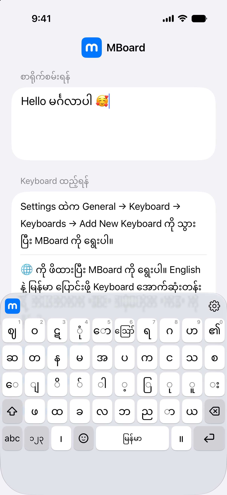
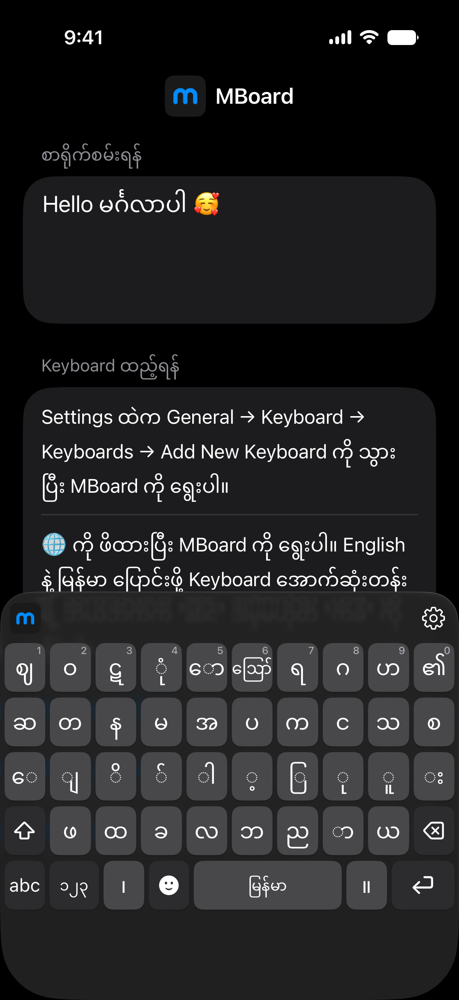
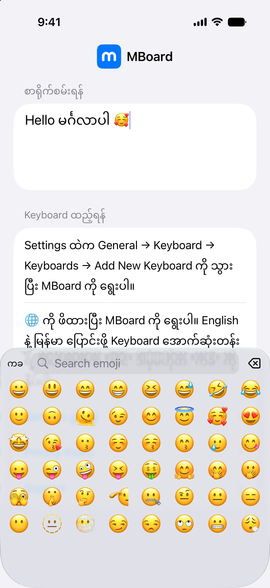

# MBoard

MBoard is an offline English and Burmese (မြန်မာ) keyboard for iPhone and iPad. You can switch languages without leaving the keyboard, complete a Burmese word in the middle of an unspaced sentence, and search emoji in either language.

  
  
  

**Release status** · Version 0.1 is in development. You can build the app from source for iPhone or iPad running iOS or iPadOS 16 or later, or try it in the simulator.

## Build from source

1. On a Mac with Xcode and an iOS simulator runtime installed, open `MBoard.xcodeproj`.
2. Select the **MBoard** scheme and an iPhone or iPad simulator, then choose **Product → Run**. Xcode installs the practice app and its keyboard extension together.
3. For your own iPhone or iPad, select your development team under **Signing & Capabilities** for both the **MBoard** and **Keyboard** targets. Use a unique app bundle identifier and give the extension the same prefix, for example `org.example.mboard` and `org.example.mboard.keyboard`. Select your paired device and run the app.

## Enable MBoard

1. Once MBoard is installed, open **Settings → General → Keyboard → Keyboards → Add New Keyboard**.
2. Choose **MBoard**.
3. In a text field, touch and hold the globe 🌐 and choose **MBoard**.

Open the MBoard app to practice typing and read the Myanmar setup instructions. Tap outside the practice field or drag the list to hide the keyboard. Tap **Settings ဖွင့်ရန်** to open iOS Settings.

## Use the keyboard

- Use the far-left key on the bottom row. Tap **abc** for English or **ကခ** for Burmese.
- Tap an English suggestion and keep typing to start the next word. Move the cursor into a misspelled word to see corrections, or choose a suggested split such as **thank you** for **thankyou**. English uses Apple’s on-device dictionary. Burmese uses a bundled word list and everyday phrases, including inside text written without spaces.
- Suggestions you pick move up for future matches. Long-press a learned suggestion and choose **Forget This Suggestion** to reset its ranking. To reset both languages, tap the settings gear at the top right and choose **Clear Learned Words → Clear for Both Languages**.
- Tap the smiley key to scroll through emoji. Tap the search field to type a query, or touch and hold an emoji to see its available skin tones.
- Tap the settings gear in the top-right corner for **Auto-Capitalization**, **Word Suggestions**, and **System**, **Light**, or **Dark** appearance. Both typing switches start on. In ordinary text fields, English words in a Burmese sentence start with a capital, as in **ဒီမှာ App Store ကိုဖွင့်ပါ**.
- Double-tap Space after a word to insert a period and a space in English, or ။ and a space in Burmese. Tap **123** or **၁၂၃** to open symbols. You can enter several digits or symbols, then press Space to return to letters.
- Select text and tap Backspace once to delete the whole selection.

Typing, suggestions, and emoji search work on your device with **Full Access** off. iOS uses its system keyboard in secure fields and in apps that require it.

## Project information

- [Unreleased changes and release notes](CHANGELOG.md)
- [Contributing, running tests, and reporting typing issues](CONTRIBUTING.md)
- [Privacy and on-device storage](PRIVACY.md)
- [Support and contact](SUPPORT.md)
- [App Store preparation](docs/APP_STORE.md)
- [Security reporting](SECURITY.md)
- [MIT license for MBoard’s original code](LICENSE) and [third-party notices](THIRD_PARTY_NOTICES.md)
