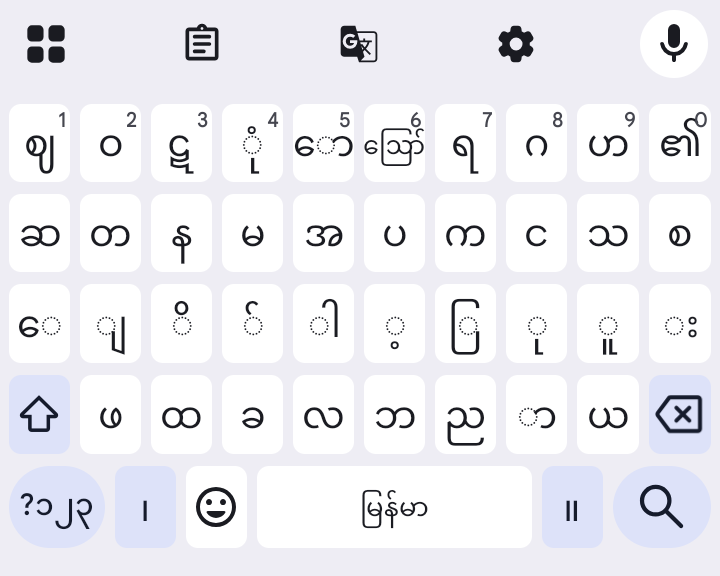
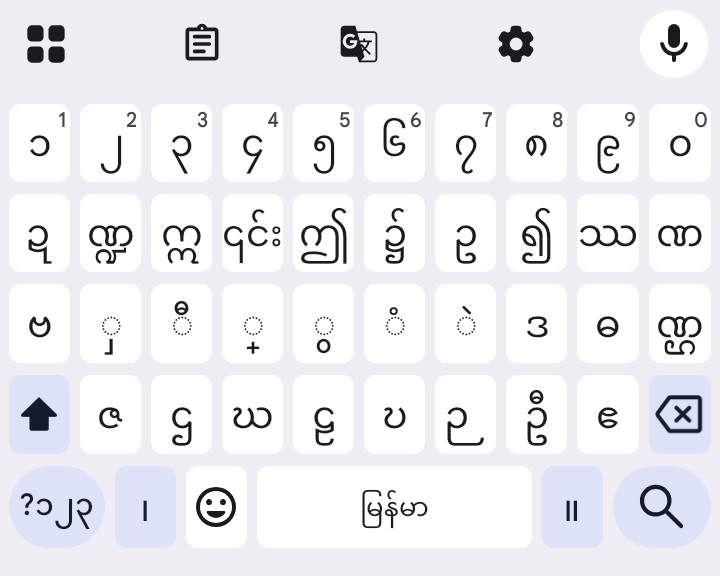
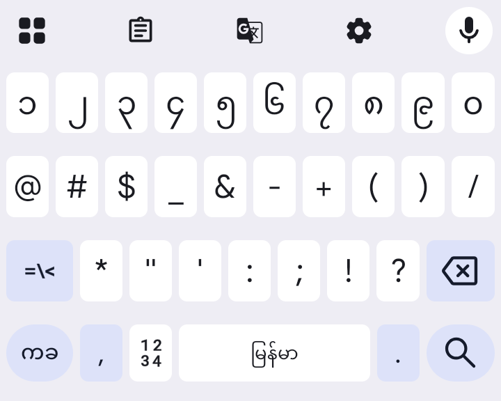
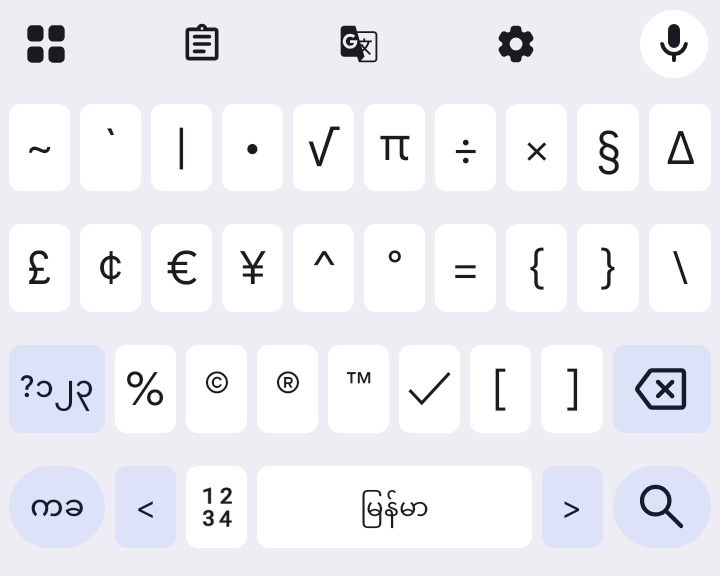

# Android Gboard Burmese reference

Observed on the user's 720 × 1600 portrait Android emulator on 25 November 2026. Gboard version `18.6.3.1002251336-release-arm64-v8a`. Its language settings showed `မြန်မာ (မြန်မာ)`, layout `မြန်မာ`, alongside English (US) QWERTY.

## Layout

The four captures show the docked keyboard in the launcher's search field. It had digit hints on the first row, four character rows, and Burmese punctuation on either side of the spacebar area. The magnifying glass was the action key for this field.

| Base | Shift |
| --- | --- |
|  |  |
| **Symbols, page 1** | **Symbols, page 2** |
|  |  |

The [character key map](character-keys.md) lists all 38 character positions, their base and Shift tap outputs, and the output of holding and releasing each base key in place. It also shows the open long-press menus. On rows 2–4, releasing a held key in place produced the same output as tapping its Shift counterpart. The top row has additional choices, including the kinzi sequence on column 4.

## Typing and deletion

Tests used touch input on Gboard's floating keyboard in its local “Search language” field. The values below came from the Android editor's accessibility text after each action. An empty field displayed its hint. These observations describe text visible to the editor, including intermediate code points. The editor's composing spans were not inspected.

| Starting state | Actions | Observed editor text |
| --- | --- | --- |
| Empty | Tap prebase vowel ေ, then က | After the vowel, `200C 1031` (zero-width non-joiner + vowel). After က, `1000 1031` (ကေ). |
| ကေ from the sequence above | Tap backspace twice | First က (`1000`), then empty. |
| Empty | Tap က, then ေ, then asat ် | `1000` → `1000 200C 1031` → `1000 200C 1031 103A`. |
| End of the preceding sequence | Tap backspace three times | `1000 200C 1031` → `1000 200C` → `1000`. Record the intermediate non-joiner when comparing implementations. |
| Empty | Tap က, medial ျ, vowel ိ, then space | က → ကျ → ကျိ → `1000 103B 102D 0020`. |
| After that space | Tap backspace twice | First ကျိ, then ကျ. The second press removed the vowel and preserved the medial. |
| Empty | Tap ေ, က, medial ျ, ာ, င, asat ်, then း | ကျောင်း (`1000 103B 1031 102C 1004 103A 1038`). |
| Empty | Tap က, virama (Shift row 3 column 4), then က | က္က (`1000 1039 1000`). Successive backspaces produced `1000 1039`, then `1000`. |
| Empty | Tap င, asat, virama, then က | င်္က (`1004 103A 1039 1000`). One backspace left `1004 103A 1039`. Holding base row 1 column 4 and then tapping က produced the same four-scalar syllable. |
| ကေ က | Move the caret left twice to just before the space, then tap Gboard backspace | က က (`1000 0020 1000`). The selection was collapsed at offset 2 before deletion. The space and following က survived. |

For an iOS regression test, compare Unicode scalars at each step. A final screenshot alone would miss U+200C. Whether to reproduce Gboard's intermediate placeholder in the host field is an implementation decision. Test the resulting text when the user leaves a composition unfinished.

## Remaining coverage

These samples cover portrait character entry and selected edits in one Android field. Shift-layer and symbol-layer holds, alternate choices selected by sliding, selection replacement, paste, and cross-field recovery still need verification where the prototype depends on them. Typing comfort and host compatibility require testing the iOS extension on an iPhone.
