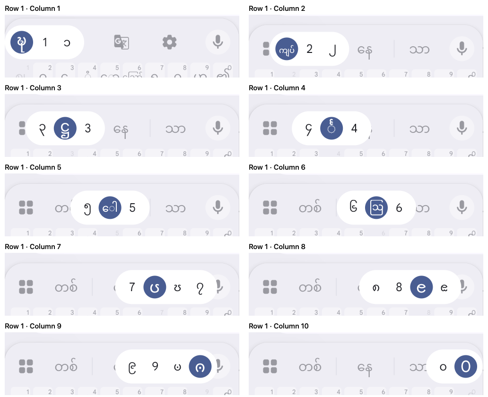
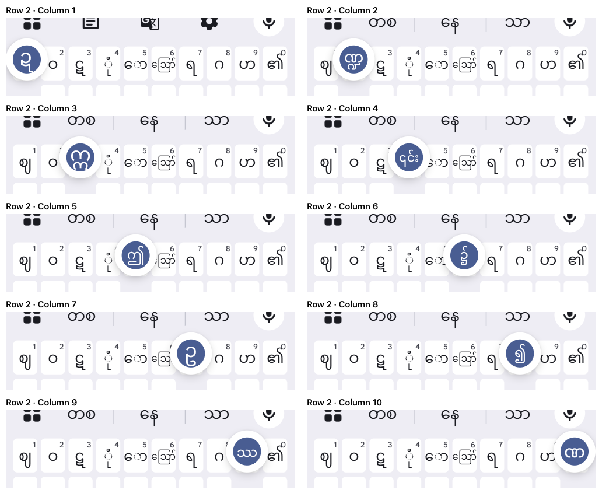
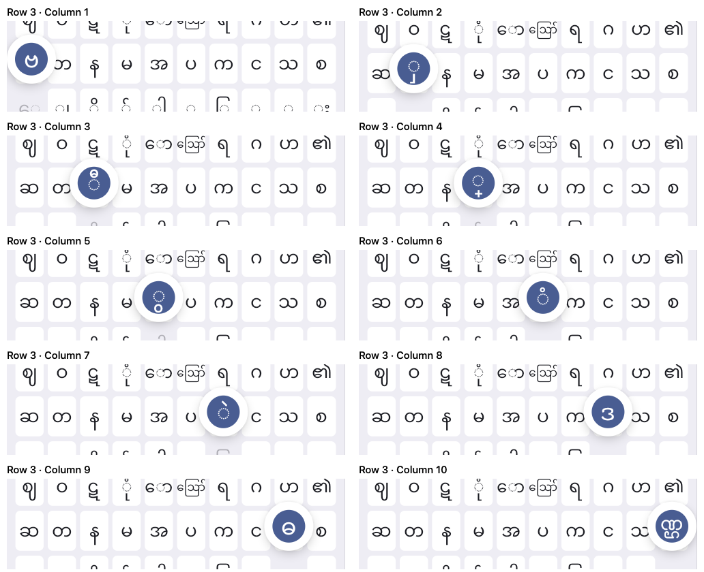
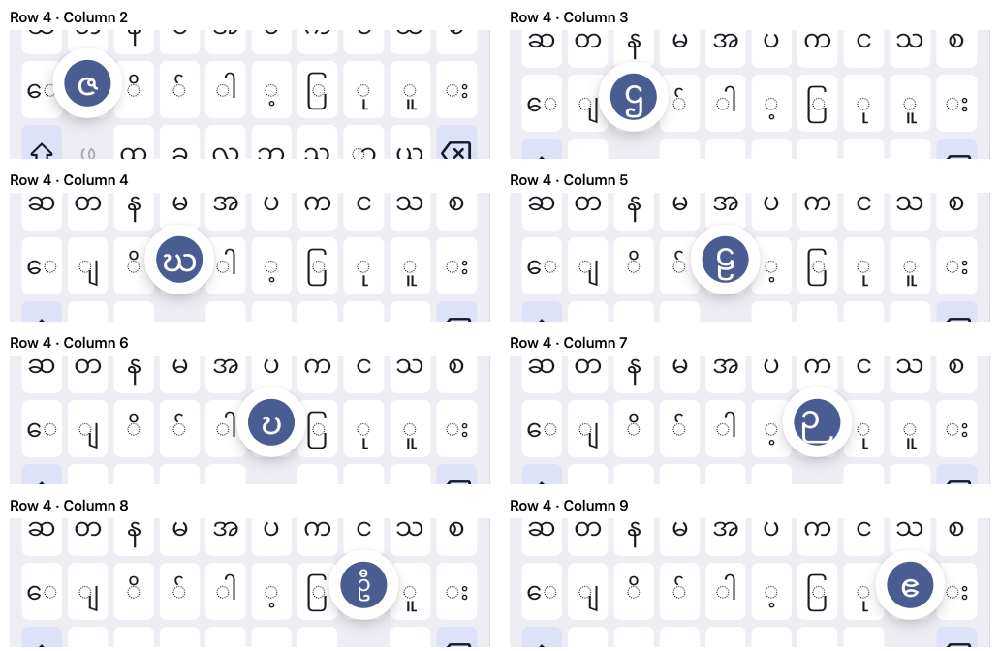

# Burmese character key outputs

Each cell gives the glyph followed by the Unicode scalar values read from the editor. Dotted circles help display combining marks in this table. Row and column positions count from the left of the docked portrait reference, including Shift as column 1 on row 4.

In the local test field, each character key was followed by a space to separate samples. Shift was tapped separately before each shifted character. The hold column records the result of lifting the finger in place on the base layer. Its popup may offer further choices.

## Row 1

| Column | Base tap | Shift tap | Base hold and release |
| --- | --- | --- | --- |
| 1 | ဈ · `1008` | ၁ · `1041` | ဍ္ဎ · `100D 1039 100E` |
| 2 | ဝ · `101D` | ၂ · `1042` | ကျပ် · `1000 103B 1015 103A` |
| 3 | ဋ · `100B` | ၃ · `1043` | ဋ္ဌ · `100B 1039 100C` |
| 4 | ◌ုံ · `102F 1036` | ၄ · `1044` | င်္ · `1004 103A 1039` |
| 5 | ◌ော · `1031 102C` | ၅ · `1045` | ◌ေါ · `1031 102B` |
| 6 | ဪ · `102A` | ၆ · `1046` | ဩ · `1029` |
| 7 | ရ · `101B` | ၇ · `1047` | ၒ · `1052` |
| 8 | ဂ · `1002` | ၈ · `1048` | ၔ · `1054` |
| 9 | ဟ · `101F` | ၉ · `1049` | ၐ · `1050` |
| 10 | ၏ · `104F` | ၀ · `1040` | 0 · `0030` |

## Row 2

| Column | Base tap | Shift tap | Base hold and release |
| --- | --- | --- | --- |
| 1 | ဆ · `1006` | ဍ · `100D` | ဍ · `100D` |
| 2 | တ · `1010` | ဏ္ဍ · `100F 1039 100D` | ဏ္ဍ · `100F 1039 100D` |
| 3 | န · `1014` | ဣ · `1023` | ဣ · `1023` |
| 4 | မ · `1019` | ၎င်း · `104E 1004 103A 1038` | ၎င်း · `104E 1004 103A 1038` |
| 5 | အ · `1021` | ဤ · `1024` | ဤ · `1024` |
| 6 | ပ · `1015` | ၌ · `104C` | ၌ · `104C` |
| 7 | က · `1000` | ဥ · `1025` | ဥ · `1025` |
| 8 | င · `1004` | ၍ · `104D` | ၍ · `104D` |
| 9 | သ · `101E` | ဿ · `103F` | ဿ · `103F` |
| 10 | စ · `1005` | ဏ · `100F` | ဏ · `100F` |

## Row 3

| Column | Base tap | Shift tap | Base hold and release |
| --- | --- | --- | --- |
| 1 | ◌ေ · `200C 1031` | ဗ · `1017` | ဗ · `1017` |
| 2 | ◌ျ · `103B` | ◌ှ · `103E` | ◌ှ · `103E` |
| 3 | ◌ိ · `102D` | ◌ီ · `102E` | ◌ီ · `102E` |
| 4 | ◌် · `103A` | ◌္ · `1039` | ◌္ · `1039` |
| 5 | ◌ါ · `102B` | ◌ွ · `103D` | ◌ွ · `103D` |
| 6 | ◌့ · `1037` | ◌ံ · `1036` | ◌ံ · `1036` |
| 7 | ◌ြ · `103C` | ◌ဲ · `1032` | ◌ဲ · `1032` |
| 8 | ◌ု · `102F` | ဒ · `1012` | ဒ · `1012` |
| 9 | ◌ူ · `1030` | ဓ · `1013` | ဓ · `1013` |
| 10 | ◌း · `1038` | ဏ္ဌ · `100F 1039 100C` | ဏ္ဌ · `100F 1039 100C` |

## Row 4

| Column | Base tap | Shift tap | Base hold and release |
| --- | --- | --- | --- |
| 2 | ဖ · `1016` | ဇ · `1007` | ဇ · `1007` |
| 3 | ထ · `1011` | ဌ · `100C` | ဌ · `100C` |
| 4 | ခ · `1001` | ဃ · `1003` | ဃ · `1003` |
| 5 | လ · `101C` | ဠ · `1020` | ဠ · `1020` |
| 6 | ဘ · `1018` | ဎ · `100E` | ဎ · `100E` |
| 7 | ည · `100A` | ဉ · `1009` | ဉ · `1009` |
| 8 | ◌ာ · `102C` | ဦ · `1026` | ဦ · `1026` |
| 9 | ယ · `101A` | ဧ · `1027` | ဧ · `1027` |

