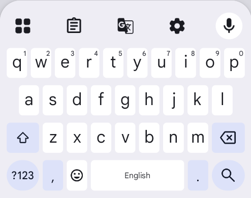
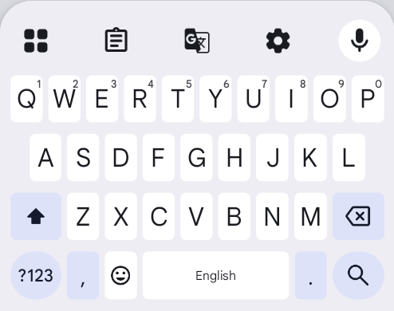
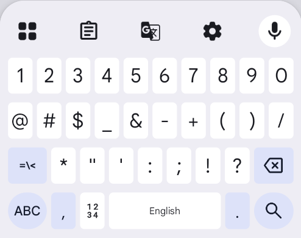
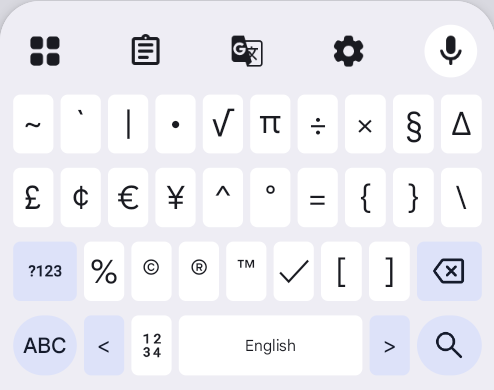
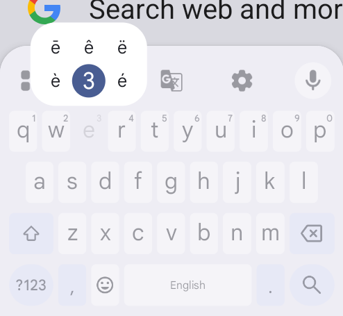
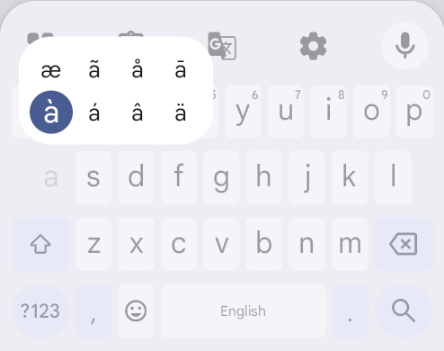
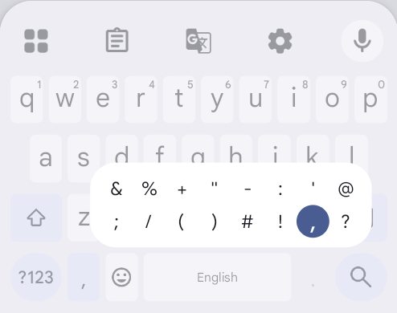
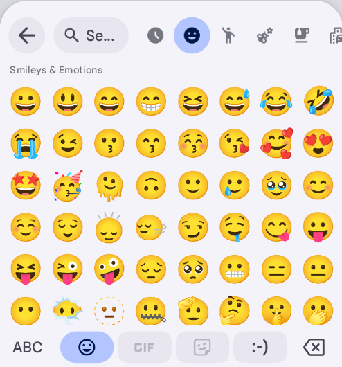
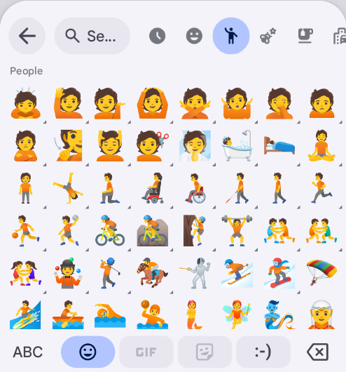
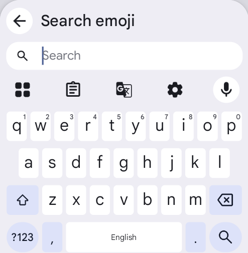

# Android Gboard English and emoji reference

Captured on the same 720 × 1600 Android emulator and Gboard 18.6.3 build used for the Burmese reference. English (US) QWERTY was active in the launcher's search field. The keyboard was floating. Use these captures for relative placement and behavior; absolute dimensions and the Search action belong to this configuration.

| Letters | Shift |
| --- | --- |
|  |  |
| **Symbols** | **More symbols** |
|  |  |

The top row has ten letters with 1–0 hints. The nine-letter home row is inset. Shift and delete flank the seven letters on the last character row. The bottom row runs from symbols through comma, smiley, English spacebar, period, and the host action. The smiley opens the picker directly. The symbol pages put a numeric-keypad shortcut in the smiley's position.

| Hold E | Hold A | Hold period |
| --- | --- | --- |
|  |  |  |

The highlighted defaults were 3, à, and comma respectively. These three menus were directly observed. Other accented-letter menus and caps-lock timing still need comparison.

## Emoji picker

| Browse | People | Search |
| --- | --- | --- |
|  |  |  |

The picker opened on Smileys & Emotions. It showed an eight-column grid, search, a recent-items clock, and horizontal category navigation. Tapping People changed the grid. Tapping search opened the full keyboard in the active language, with English and Myanmar both observed. Typing `cat` extended the results above the query field while the keys stayed full size. ABC returned to letters. The lower bar also exposed delete and media controls. MBoard uses system emoji glyphs and a local Unicode catalog.

## Typing settings observed on November 26, 2026

The emulator ran Gboard 18.6.3.1002251336 with English (US) QWERTY and Burmese enabled. In **Corrections & suggestions**, **Auto-capitalization** was on and its description specified the first word of each sentence. **Suggestion strip** and **Word suggestions** were separate switches, both on. Auto-correction, spell check, grammar check, and next-word suggestions were also on. Contact suggestions were off.

In **Preferences**, the regular number row was off. The dedicated emoji, comma, and period keys were on. The dedicated language-switch key was off. MBoard adopts the auto-capitalization and word-suggestion switches while retaining its existing language control.
